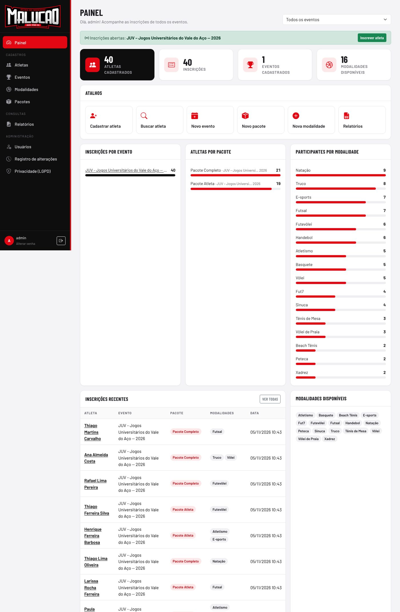
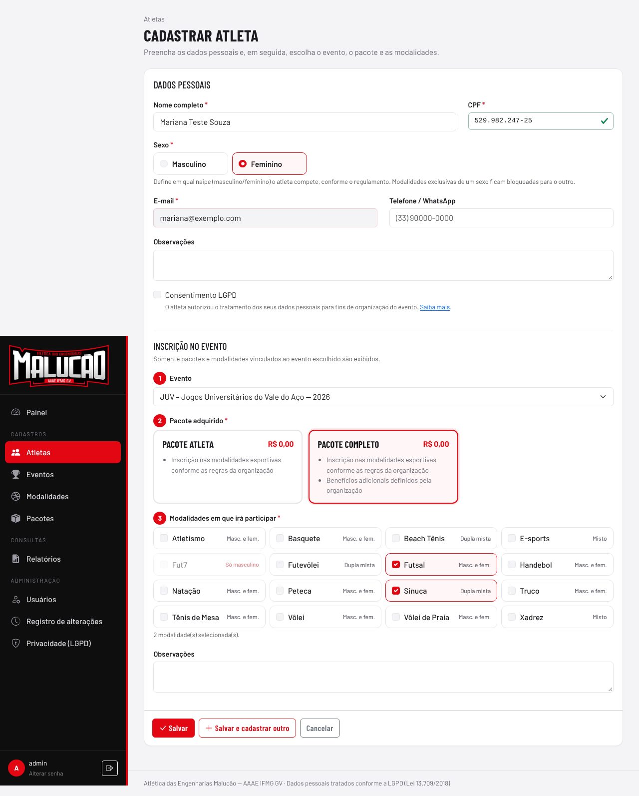
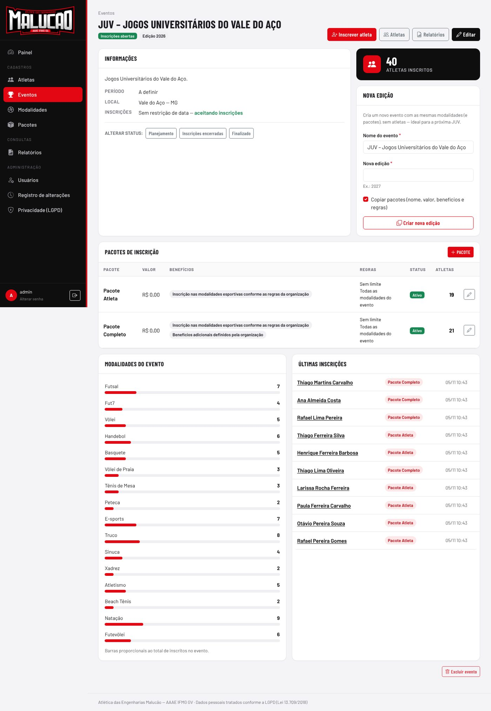
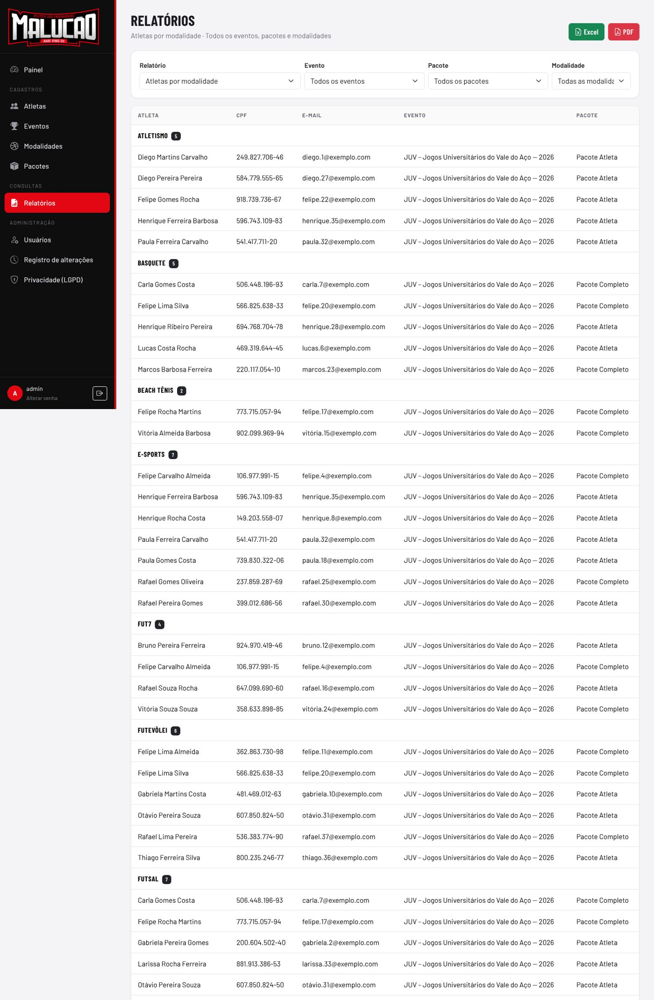
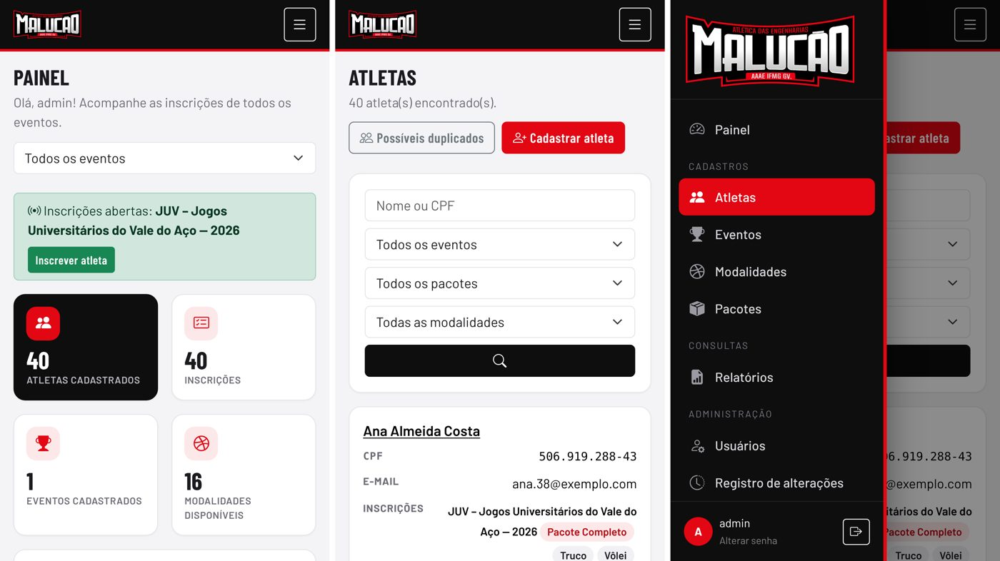

# Malucão Eventos — Sistema de Gestão de Eventos Esportivos

Plataforma web da **Atlética das Engenharias Malucão (AAAE IFMG GV)** para gerenciar eventos esportivos
universitários: atletas, modalidades, eventos, pacotes de inscrição, relatórios e auditoria.
O primeiro evento cadastrado é a **JUV – Jogos Universitários do Vale do Aço**. A estrutura comporta novas
edições e outros eventos sem mudança no código.



## Funcionalidades

| Módulo | O que faz |
|---|---|
| **Painel** | Total de atletas, inscrições por evento, atletas por pacote, participantes por modalidade, eventos, modalidades disponíveis, inscrições recentes e atalhos. Filtro por evento. |
| **Atletas** | Cadastro (nome, CPF, **sexo**, e-mail, telefone, consentimento LGPD), edição, exclusão, busca por nome/CPF/e-mail, filtros por evento, pacote e modalidade, histórico de inscrições e alterações. |
| **Inscrição** | No cadastro do atleta: **evento → pacote → modalidades**. Aparecem só os pacotes e modalidades **vinculados ao evento escolhido**, e as regras do pacote são aplicadas. |
| **Duplicidade** | CPF único no banco, com aviso em tempo real ao digitar um CPF já cadastrado (e atalho para adicionar a inscrição ao cadastro existente). Também há a tela “Possíveis duplicados” (mesmo nome ou e-mail com CPFs diferentes). |
| **Modalidades** | As 16 modalidades da JUV vêm pré-cadastradas. Tipo (individual, dupla ou coletiva), **naipe** (veja abaixo), ativar/desativar, total de eventos e de participantes. |
| **Eventos** | Nome, edição, descrição, datas, local, status (planejamento, inscrições abertas, inscrições encerradas, finalizado) e período de inscrições. Modalidades vinculadas, pacotes, quantidade de inscritos, consulta a eventos anteriores e futuros, e **“Criar nova edição”**, que copia modalidades e pacotes sem levar os atletas. |
| **Pacotes** | Nome, descrição, valor, evento, benefícios (um por linha), status e **regras**: limite de modalidades por atleta e modalidades permitidas. Mostra a quantidade de atletas por pacote. |
| **Relatórios** | Filtro por **sexo** e contagens masculino/feminino. Atletas por modalidade agrupados por disputa (ex.: *Futsal Masculino* e *Futsal Feminino*). Lista geral de inscritos, atletas por modalidade, atletas por pacote, quantidade por modalidade, por evento e por pacote (com receita estimada) e relação completa. Filtros por evento, pacote e modalidade. **Exportação em Excel e PDF.** |
| **Usuários** | Gestão de usuários e perfis de acesso. |
| **Auditoria** | Registro de criações, alterações (campo a campo, com o valor anterior e o novo), exclusões, exportações e logins, com usuário e IP. Os registros não podem ser editados. |

### Sexo e naipes (regulamento da JUV)

O sexo do atleta é obrigatório e define em qual naipe ele compete. Cada modalidade tem um naipe:

| Naipe | Regra | Modalidades da JUV |
|---|---|---|
| Masculino e feminino | disputas separadas por sexo | Futsal, Vôlei, Handebol, Basquete, Vôlei de Praia, Tênis de Mesa, Peteca, Truco, Atletismo, Natação |
| Somente masculino | atleta feminina não pode ser inscrita | Fut7 (Futebol Society Masculino) |
| Somente feminino | atleta masculino não pode ser inscrito | — |
| Misto | aberto a qualquer sexo | Xadrez, E-sports |
| Dupla/equipe mista | aberto a ambos; a equipe precisa de homens e mulheres | Sinuca, Beach Tênis, Futevôlei |

Na inscrição, as modalidades exclusivas do outro sexo ficam bloqueadas. O relatório de quantidades avisa quando
uma dupla mista não tem ao menos 1 homem e 1 mulher inscritos.

### Regras de relacionamento

```
Evento ──< Pacote                  (um evento tem vários pacotes; cada pacote pertence a um evento)
Evento >──< Modalidade             (um evento tem várias modalidades; uma modalidade, vários eventos)
Atleta ──< Inscrição >── Evento    (um atleta pode se inscrever em vários eventos, uma vez em cada)
Inscrição >── Pacote               (cada inscrição tem um pacote, que precisa ser do mesmo evento)
Inscrição >──< Modalidade          (várias modalidades por inscrição, todas do evento e permitidas pelo pacote)
```

Validações aplicadas no servidor (também refletidas na tela):
- o pacote precisa pertencer ao evento;
- as modalidades precisam estar ativas, vinculadas ao evento e permitidas pelo pacote;
- o sexo do atleta precisa ser compatível com o naipe da modalidade;
- o número de modalidades respeita o limite do pacote;
- um atleta tem só uma inscrição por evento;
- novas inscrições exigem o status *Inscrições abertas* e a data dentro do período, se houver um definido. Somente perfis com a permissão “inscrever fora do período” (Administrador) passam por cima dessa regra.

## Segurança e LGPD

- Login obrigatório e **bloqueio após 5 tentativas incorretas** (django-axes).
- **Perfis de permissão** criados automaticamente:
  - **Administrador:** acesso total.
  - **Operador de inscrições:** cadastra atletas e inscrições e exporta relatórios.
  - **Consulta:** somente leitura, com CPF mascarado.
- O **CPF completo** aparece só para quem tem permissão. Os demais veem `***.982.247-**`, inclusive nos relatórios e exportações. Na auditoria o CPF fica sempre mascarado.
- Validação de **CPF** (dígitos verificadores) e de **e-mail**.
- Consentimento do titular registrado com data. A exclusão do atleta atende ao direito de eliminação.
- A sessão expira por inatividade. Cookies `HttpOnly`/`Secure`, `X-Frame-Options: DENY` e HTTPS em produção.
- Página **Privacidade (LGPD)** dentro do sistema.
- **Backup** com `python manage.py backup_db`: usa `pg_dump` no PostgreSQL e a cópia online no SQLite, gera também um JSON portátil e mantém os 14 mais recentes. No Docker, o backup roda sozinho a cada 24 h.

## Tecnologias

Python 3.12+ · Django 5.2 LTS · PostgreSQL (produção) / SQLite (desenvolvimento) · Bootstrap 5 com tema próprio
(sem CDN, tudo servido localmente) · openpyxl (Excel) · ReportLab (PDF) · WhiteNoise · Gunicorn.

## Como rodar (desenvolvimento)

```bash
git clone https://github.com/mrochapd/MALUCAO.git && cd MALUCAO
```

```bash
python -m venv .venv && source .venv/bin/activate   # Windows: .venv\Scripts\activate
```

```bash
pip install -r requirements.txt
```

```bash
cp .env.example .env    # ajuste usuário e senha do administrador
```

```bash
python manage.py migrate
```

```bash
python manage.py setup_inicial            # perfis, 16 modalidades, JUV e pacotes (+ superusuário do .env)
```

```bash
python manage.py runserver
```

Acesse http://127.0.0.1:8000 e entre com o usuário definido em `DJANGO_SUPERUSER_USERNAME`/`DJANGO_SUPERUSER_PASSWORD`.
Para gerar atletas fictícios de demonstração, use `python manage.py setup_inicial --demo 40`.

> A JUV é criada com status **Planejamento** e pacotes com valor R$ 0,00. Antes de abrir as inscrições,
> edite o evento (datas, local, status) e os pacotes (valores, benefícios e regras).

### Testes

```bash
DJANGO_TESTING=1 python manage.py test
```

Os testes também rodam no GitHub Actions com PostgreSQL a cada push (`.github/workflows/testes.yml`).

## Produção com Docker

```bash
cp .env.example .env    # DJANGO_DEBUG=0, DJANGO_SECRET_KEY longa, DJANGO_ALLOWED_HOSTS, senhas
```

```bash
docker compose up -d --build
```

Sobe três serviços: a aplicação (Gunicorn na porta 8000), o PostgreSQL 16 e o backup diário (gravado em `./backups`).
Coloque um proxy reverso com HTTPS na frente (Nginx, Caddy, Traefik) e defina `DJANGO_CSRF_TRUSTED_ORIGINS`.

Sem Docker, com backup agendado no cron:

```bash
0 3 * * * cd /caminho/do/projeto && .venv/bin/python manage.py backup_db
```

Para restaurar um backup PostgreSQL: `pg_restore -d malucao malucao-AAAAMMDD-HHMMSS.dump`. O JSON funciona em
qualquer banco: `python manage.py loaddata malucao-...json.gz`.

## Estrutura

```
config/        configurações e rotas
core/          painel, auditoria, usuários, validação de CPF, comandos setup_inicial e backup_db
eventos/       modalidades, eventos, pacotes e suas regras
atletas/       atletas e inscrições
relatorios/    relatórios e exportação Excel/PDF
templates/     telas (Django templates + Bootstrap)
static/        CSS/JS próprios, logos da Malucão e bibliotecas locais
```

O `/admin/` do Django continua disponível para superusuários como administração avançada.

## Telas

| Cadastro de atleta com inscrição | Evento |
|---|---|
|  |  |

| Relatórios | Celular |
|---|---|
|  |  |
